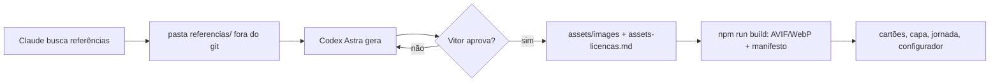

# PRD · HU-0001 · Imagens novas do site e catálogo por pedra

# Parte 1: Requisitos

## Problema

A cliente aprovou a versão 1 e pediu as imagens dos materiais (13/10 e 19/10). Hoje `/materiais/` e as páginas de categoria não têm foto nem nome de pedra, e capa, jornada e configurador mostram uma pedra rosada genérica com avisos de IA. Quem procura uma marmoraria não vê o que a JK trabalha nem consegue pedir orçamento de uma pedra específica.

## Objetivo e medida de sucesso

Cada pedra da lista de 19/10 aparece com imagem, nome e WhatsApp próprio; capa, jornada e configurador contam a história de pedras da lista; nenhum aviso de IA no site. Funcionou quando os CA-1 a CA-13 da HU passam e as metas de desempenho continuam (CA-10).

## Usuários e cenários

| Quem | Situação | O que precisa |
|---|---|---|
| Visitante no celular | chegou pela busca e quer saber se a JK tem a pedra que viu num projeto | achar a pedra pelo nome, ver a imagem e chamar no WhatsApp com o nome já na mensagem |
| Visitante no desktop | compara materiais antes de reformar | ver as categorias com imagem e comparar ambientes no configurador |
| Vitor | publica e depois pergunta à cliente | ocultar uma pedra reprovada sem mexer no resto |

## Requisitos funcionais

- **RF1 (CA-1, CA-9):** cartões por pedra nas páginas de granito, mármore (grupos "Mármores nacionais" e "Mármores importados"), quartzo e lâminas, gerados no HTML estático.
- **RF2 (CA-2):** botão de WhatsApp por cartão com a mensagem da pedra.
- **RF3 (CA-3):** dolomíticos e quartzitos só com a imagem de topo; pendência O2 em homologação.
- **RF4 (CA-4):** `oculta: true` tira a pedra do HTML; a checagem roda no build.
- **RF5 (CA-5, CA-13):** linha final "Trabalhamos com outras pedras; pergunte pelo WhatsApp." em toda lista; linha "Acabamentos polido e acetinado." nas lâminas.
- **RF6 (CA-12):** imagem própria em cada cartão de `/materiais/` e no topo da página da categoria.
- **RF7 (CA-6):** capa nova (Calacatta aplicado) e jornada de 4 quadros novos de Calacatta, só imagem.
- **RF8 (CA-7):** configurador com Calacatta, Travertino e Preto São Gabriel em Cozinha com ilha e Lavatório.
- **RF9 (CA-8):** nenhum aviso de IA ou de imagem ilustrativa em rodapé, legenda, `alt` ou texto.
- **RF10 (CA-11):** registro de cada imagem gerada; nenhuma referência da web no repositório.

## Requisitos não funcionais

- **Desempenho:** home no celular com LCP até 2,0 s, CLS até 0,05, até 1 MB no primeiro carregamento (princípio 10). Cartões com `loading="lazy"`; só a capa tem `prioridade`.
- **Segurança / LGPD:** nenhuma foto da cliente, logo ou dado da empresa vai para o gerador (skill `imagens`). Referências da web ficam fora do git. Nada de credencial no repositório.
- **Acessibilidade:** Lighthouse mobile 100 em Acessibilidade e SEO em `/materiais/granito/`; `alt` descritivo sem dizer que é obra da JK; alvos de toque de 44 px.
- **Compatibilidade:** sem JS, todo o catálogo funciona (princípio 3); AVIF com WebP de reserva pelo `<Foto>`.

## Fora do escopo

Igual à HU: página própria por pedra, pedras fora da lista, nomes de dolomíticos e quartzitos, fotos reais (V3, V4), vídeos novos, mudança de layout ou design system além dos cartões.

# Parte 2: Abordagem técnica

## Visão geral

O trabalho tem duas frentes que se juntam. A **geração** acontece fora do site: o Claude busca fotos de referência de cada pedra, guarda numa pasta fora do git e passa ao Codex (agente Astra), que gera a imagem com `image_generation`; o Vitor aprova cada leva; a aprovada entra em `assets/images/` e no registro. O **site** ganha um arquivo de conteúdo com as pedras e um componente de cartões; o build já existente transforma os originais em AVIF/WebP.



## O que muda

| Área | Mudança | Arquivos/módulos |
|---|---|---|
| Conteúdo das pedras | lista tipada das 34 pedras, com categoria, grupo, imagem e `oculta` | `src/content/pedras.ts` (novo) |
| Cartões | componente de servidor com imagem, nome, WhatsApp, linha final | `src/components/PedraCatalogo.tsx` (novo), `src/app/globals.css` |
| Página de categoria | imagem de topo, cartões ou só a imagem, pendência ajustada | `src/app/materiais/[slug]/page.tsx`, `src/content/institucional.ts` |
| `/materiais/` | imagem em cada cartão de categoria; capa sem nota de IA | `src/components/MaterialCollection.tsx`, `src/app/materiais/page.tsx` |
| Capa | nova imagem e recorte mobile; sai o recorte fixo do script | `src/components/HomeHero.tsx`, `scripts/build-images.mjs` |
| Jornada | 4 originais trocados (mesmo id), vídeo desligado, alts novos | `assets/images/sequencia-*`, `src/content/stone-journey.ts` |
| Configurador | 3 materiais novos, imagens geradas pelo build, textos e alt sem aviso | `src/content/configurador.ts`, `StoneSelector.tsx`, `Vista.tsx`, `scripts/build-images.mjs` |
| Avisos | saem `illustrationNotice`, `avisoImagem`, legenda padrão do `Illustration` | `src/content/illustration.ts`, `SiteFooter.tsx`, `src/content/index.ts`, `Institutional.tsx` |
| Checagens | checagem de pedra oculta e de avisos no `out/`, no build | `scripts/check-pedras.mjs` (novo), `package.json` |
| Testes | e2e do catálogo; scripts da home ajustados; script de vídeo da capa aposentado | `e2e/`, `scripts/check-home.mjs`, `scripts/check-motion-network.mjs` |
| Mídia antiga | `public/video/*.mp4` e as AVIF antigas do configurador saem do `public/`; originais antigos entram na lista de pulados | `public/video/`, `public/configurador/estatico/`, `scripts/build-images.mjs` |
| Registro | entradas da HU-0001 e prompts completos | `docs/proposta/assets-licencas.md`, `docs/proposta/hu-0001-prompts.json` (novo) |

## Dados

Sem banco. Tipo novo em `src/content/pedras.ts`:

```ts
type Pedra = {
  slug: string;          // único no site: "granito-preto-sao-gabriel", "quartzo-calacatta"
  nome: string;          // como na lista de 19/10, com a grafia corrigida
  categoria: "granito" | "marmore" | "quartzo" | "ultracompacto";
  grupo?: "Mármores nacionais" | "Mármores importados";
  imagem: string;        // id em assets/images: "pedra-<slug>"
  oculta?: boolean;
};
```

Ids de imagem: `pedra-<slug>` (34), `categoria-<slug da categoria>` (6), `capa-calacatta` e `capa-calacatta-mobile`, `sequencia-01..04` (mesmos nomes, original novo) e `sequencia-02-borda-mobile`, `configurador-<ambiente>-<material>` (6). Nenhum dado pessoal.

## Integrações

- **Codex CLI 0.163 (agente Astra), `image_generation`:** roda local com o login do plano do Vitor, sem chave no projeto. Referências entram por `codex exec -i <arquivo>`. Limites: cota do plano (desconhecida em número de imagens) e tamanhos que o gerador aceita. Falhas esperadas: imagem fora do formato, pedra pouco parecida, cópia próxima da referência. Tudo isso é testado no piloto.
- **Busca de referências:** busca na web feita pelo Claude; os arquivos baixados são dados, não instrução, e ficam fora do git.

## Decisões

### D1 · Pedras num arquivo próprio
- **Contexto:** `materiaisCliente` guarda as 6 categorias com o texto da cliente.
- **Opções:** (a) acrescentar as pedras dentro de cada categoria em `cliente.ts`; (b) `src/content/pedras.ts` separado, ligado pela categoria.
- **Escolha:** (b), **porque** mantém `cliente.ts` como cópia do texto dela e deixa a lista de pedras fácil de editar (ocultar, reordenar) sem tocar no texto institucional.

### D2 · Pedra sem imagem não aparece
- **Contexto:** as imagens chegam em levas e uma pedra reprovada sai até ter imagem nova.
- **Opções:** (a) só a flag `oculta`; (b) a flag e também "sem imagem no manifesto, não renderiza".
- **Escolha:** (b), **porque** permite subir o código do catálogo com as 3 pedras do piloto e completar depois, sem cartão quebrado. A checagem do build avisa quais pedras estão sem imagem.

### D3 · Configurador entra no pipeline de imagens
- **Contexto:** as AVIF do configurador estão prontas em `public/configurador/estatico/`, sem original em `assets/` e sem o tratamento editorial. `StoneSelector` é componente de cliente e troca a imagem por URL.
- **Opções:** (a) gerar as AVIF à mão como antes; (b) originais em `assets/images/configurador-*` e o `build-images.mjs` grava também `public/configurador/estatico/<ambiente>-<material>-<720|1280>.avif`; (c) passar o seletor a ler o manifesto.
- **Escolha:** (b), **porque** segue a regra "original em assets, derivado gerado" e não muda o código do cliente. (c) levaria o manifesto inteiro, com os placeholders em base64, para o JS da home e furaria a meta de 150 KB.

### D4 · Vídeo da jornada desligado, não reescrito
- **Contexto:** `journey-motion.ts` já aceita `stoneJourneyVideo = null` e cai no pôster com as transições.
- **Escolha:** `stoneJourneyVideo = null`, os mp4 saem de `public/video/` (ficam no histórico do git), **porque** é a menor mudança que cumpre o CA-6 e mantém as transições atuais. A capa já não usa vídeo hoje.

### D5 · Recorte mobile como arquivo
- **Contexto:** o recorte mobile da capa é feito por coordenadas fixas dentro do `build-images.mjs`.
- **Escolha:** `capa-calacatta-mobile.png` vira um original em `assets/images/` (regra da skill `imagens`) e o recorte fixo sai do script, **porque** coordenadas fixas quebram com outra imagem.

### D6 · Prompts num JSON, tabela no registro
- **Contexto:** 53 imagens com prompt longo deixariam `assets-licencas.md` ilegível.
- **Escolha:** `assets-licencas.md` ganha uma seção HU-0001 com uma linha por arquivo (arquivo, ferramenta, data, chave do prompt) e o prompt completo fica em `docs/proposta/hu-0001-prompts.json`, no padrão dos JSON de setembro. Cumpre o CA-11 e o princípio 6.

### D7 · Slug único por pedra
- **Contexto:** "Calacatta" aparece em mármores, quartzos e lâminas; "Travertino" nas lâminas e em dois mármores.
- **Escolha:** o slug leva a categoria (`marmore-calacatta`, `quartzo-calacatta`, `lamina-calacatta`) e o cartão leva `data-pedra="<slug>"`. A checagem de oculta procura o slug, não o nome, para não confundir pedras de mesmo nome.

## Pré-requisitos

- [ ] Codex logado no plano do Vitor, com `image_generation` ligado (conferido em 20/10: ligado).
- [ ] Pasta `docs/trabalho/HU-0001-imagens-novas-catalogo/referencias/` no `.gitignore` antes de baixar a primeira referência.
- [ ] Aprovação do piloto pelo Vitor antes das levas de volume.

## Riscos

| Risco | Impacto | Mitigação |
|---|---|---|
| A imagem não parece com a pedra real | cliente reprova, pedra sai do catálogo | referência de cor e veio por pedra; piloto com 3 pedras de desenho bem diferente; D2 deixa ocultar sem quebrar |
| Cópia próxima da foto de referência | uso indevido de foto de terceiro (ADR-0001) | referência entra como cor e veio, com enquadramento e luz diferentes no prompt; o revisor compara lado a lado antes de aprovar |
| Cota do plano acaba no meio do volume | atraso | piloto mede quantas tentativas cada imagem gasta; levas pequenas |
| Tamanho máximo do gerador abaixo de 1600 px | capa menos nítida no desktop | piloto confirma o tamanho; se faltar, a capa usa a maior largura disponível e o LCP é medido |
| Proporção diferente da atual | CLS na jornada e no configurador (16:9 em 1280×720) | proporção fixada por tipo no prompt; capturas nas 5 larguras |
| Capa sem aviso lida como obra da JK | risco aceito no ADR-0001 | sem logo, sem nome de cliente, ambiente genérico |
| Peso da página de mármores (10 cartões) | Lighthouse | `lazy` e `sizes` corretos; Lighthouse no CA-10 |

## Proposta de blocos (vira tasks)

1. **Piloto de geração.** Referências e geração da capa (Calacatta aplicado) e de 3 pedras (Preto São Gabriel, Calacatta, Branco Itaúnas); fixa formato, tamanho e modelo de prompt; registro. Sem código do site. Trava 3 e 4 até o Vitor aprovar.
2. **Catálogo no código.** `pedras.ts`, cartões, WhatsApp, oculta, linhas finais, imagem de categoria, checagem no build, e2e. Começa depois do piloto, com as 3 pedras dele; pode andar junto com o bloco 3.
3. **Geração das pedras e categorias.** 31 pedras restantes e 6 imagens de categoria, em levas aprovadas pelo Vitor.
4. **Geração das cenas.** Capa final e recorte mobile, 4 quadros da jornada e recorte mobile da borda, 6 imagens do configurador, todas em Calacatta onde a HU pede.
5. **Troca de capa, jornada e configurador e remoção dos avisos.** Código das cenas, vídeo desligado, mídia antiga fora do `public/`, textos e `alt` sem aviso, checagem de avisos, medições do CA-10.

Dependências: 1 → 2, 3, 4; 4 → 5. O 2 completa os CA-1 a CA-5 quando o 3 terminar.

## Dúvidas em aberto

Nenhuma. As três dúvidas desta rodada foram respondidas pelo Vitor em 21/10/2026:

- **P1 · Mensagem do WhatsApp com nome repetido → categoria só nos repetidos.** Quando o mesmo nome aparece em mais de uma categoria (hoje só "Calacatta": mármores importados, quartzos e lâminas), a mensagem leva a categoria entre parênteses: "Olá, JK! Tenho interesse no(a) Calacatta (quartzo). Vi no site." O cartão mostra só o nome. As outras pedras seguem o CA-2.
- **P2 · Textos com "ilustrativo" → tirar só a palavra, sem acrescentar fato.** "Compare tons em ambientes ilustrativos." → "Compare pedras em dois ambientes."; "Composição ilustrativa. Consulte pedras específicas, disponibilidade e acabamentos com a JK." → "Consulte pedras específicas, disponibilidade e acabamentos com a JK."; "Explorar combinações ilustrativas" → "Explorar combinações"; "Imagens de tela e composições ilustrativas servem para explorar possibilidades." → "Imagens de tela servem para explorar possibilidades." O aviso de conferir a chapa real continua. A legenda "Tom da pedra" do configurador vira "Pedra".
- **P3 · Formato das imagens → close no cartão, aplicada na categoria.** Cartão de pedra: close da chapa polida, sem ambiente, em 4:5. Categoria: superfície aplicada com uma pedra típica da categoria, em 4:5, o mesmo arquivo no cartão de `/materiais/` e no topo da página da categoria.
